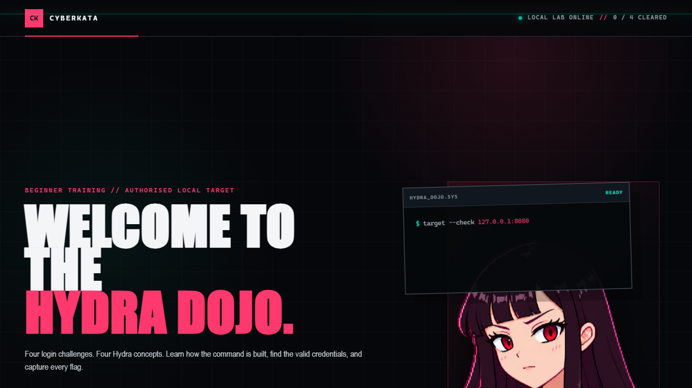
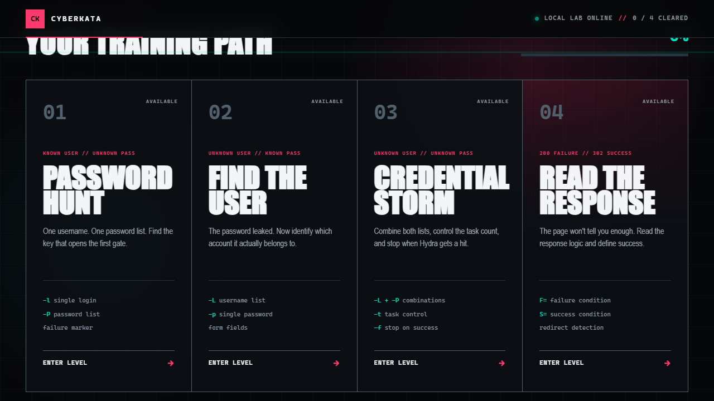
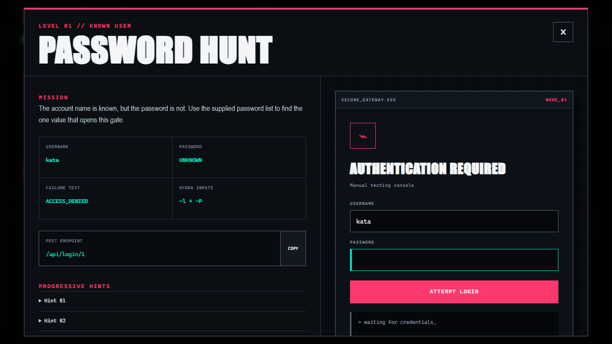
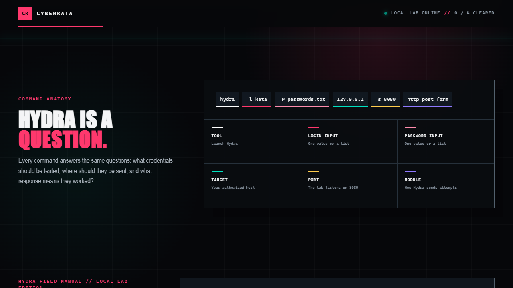
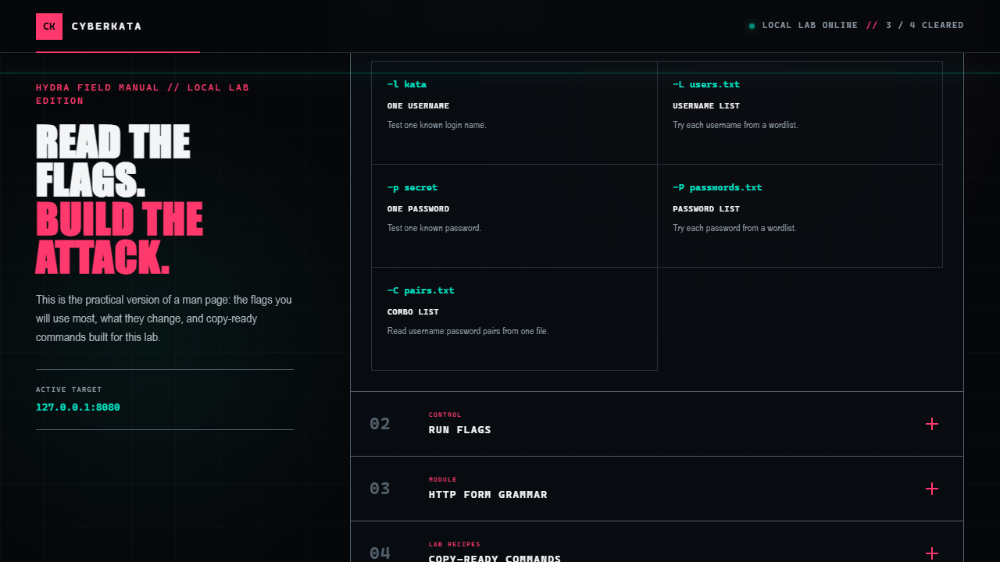
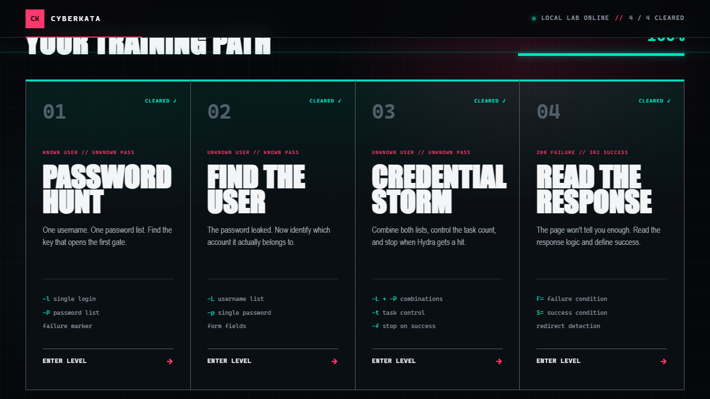

# Brute Force with Hydra

> A beginner-friendly, practical Hydra lab that runs locally with Python—no Docker required.




This lesson teaches the parts of a Hydra command by giving you a real local target to test. You will complete the first three levels as a guided progression, then use what you learned to solve the fourth.

## Download the lab

### [Download CyberKata Hydra Dojo](CyberKata-Hydra-Dojo.zip)

After downloading, extract the ZIP before launching it. The archive contains a single `cyberkata-hydra-lab` folder with the server, launchers, wordlists, tests, and full offline interface.

## What you will learn

- The difference between `-l`, `-L`, `-p`, and `-P`.
- How to select a host, port, and Hydra module.
- How an HTTP form maps to a Hydra `http-post-form` command.
- How failure and success strings tell Hydra whether an attempt worked.
- How to control task count and stop after the first valid result.
- How to read a command instead of blindly copying it.



## Quick start

### Windows

1. Install [Python 3](https://www.python.org/downloads/) and enable **Add Python to PATH** during setup.
2. Download and extract `CyberKata-Hydra-Dojo.zip`.
3. Open the extracted `cyberkata-hydra-lab` folder.
4. Double-click `START-LAB.bat`.
5. Open `http://127.0.0.1:8080` if the browser does not open automatically.

The target runs on Windows, but Hydra is easiest to use from Kali Linux or another Linux environment. If Kali is in a virtual machine, use the VM instructions below.

### Kali Linux or another Linux system

Install Hydra if it is not already available:

```bash
sudo apt update
sudo apt install hydra -y
```

Extract the ZIP, enter the lab directory, and start the target:

```bash
cd cyberkata-hydra-lab
chmod +x START-LAB.sh
./START-LAB.sh
```

Alternatively, launch the server directly:

```bash
python3 server.py
```

Then open `http://127.0.0.1:8080` and keep the server terminal running. Use a second terminal for your Hydra commands.

### Kali in a virtual machine

Run the VM launcher on the machine hosting the lab:

```bash
./START-LAB-FOR-VM.sh
```

On Windows, double-click `START-LAB-FOR-VM.bat`. The launcher prints the address your Kali VM should use. Keep the service on a trusted private network and stop it when the lesson is complete.

## The four levels

### 01 — Password Hunt

The username is known. Use one login with a password list and identify the value that opens the first gate.



### 02 — Find the User

The password is known. Switch from a single login to a username list and determine which account owns it.

### 03 — Credential Storm

Combine both lists, control the task count, and stop when Hydra finds a valid pair.

### 04 — Read the Response

The final page does not expose a useful failure message. Inspect the response behavior, define success correctly, and complete this level independently.

## Understand the command

The interface includes an anatomy view and a Hydra field manual. These sections explain the command one component at a time and provide copyable examples adapted to the local host and port.





## Included files

```text
cyberkata-hydra-lab/
├── app/                       Offline web interface
├── solutions/                 Instructor reference
├── tests/                     Smoke and Hydra end-to-end tests
├── wordlists/                 Training usernames and passwords
├── server.py                  Python standard-library target
├── START-LAB.bat              Windows local launcher
├── START-LAB.sh               Linux local launcher
├── START-LAB-FOR-VM.bat       Windows VM-access launcher
└── START-LAB-FOR-VM.sh        Linux VM-access launcher
```

## Verify the lab

The included smoke test checks static files, path traversal protection, all four login patterns, redirect handling, progress tracking, and concurrent attempts:

```bash
python tests/smoke_test.py
```

For a full Hydra-driven test on Linux:

```bash
chmod +x tests/hydra_e2e.sh
./tests/hydra_e2e.sh
```

## Troubleshooting

- **`python` is not recognized:** reinstall Python and enable **Add Python to PATH**, or try `py server.py` on Windows.
- **Port 8080 is already in use:** stop the other service or launch with `python server.py --port 8081`.
- **Kali cannot reach the host:** use the VM launcher, confirm both systems are on the same private network, and allow the chosen port through the host firewall only for that private network.
- **Hydra reports no valid password:** make sure you are inside the extracted lab directory and copied the exact form fields and response marker shown by the current level.

## Safety boundary

This is an intentionally vulnerable target built for your own local machine. Only test systems you own or have explicit written permission to assess. Do not expose this lab to the public internet, and stop the server with `Ctrl+C` when finished.



[Back to all CyberKata lessons](../../)
